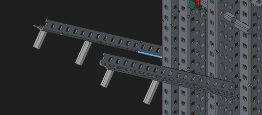
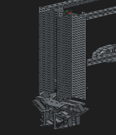
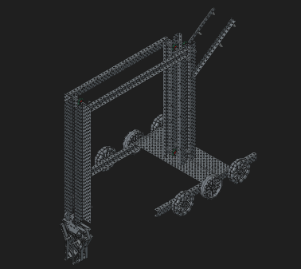

## First Design Ideas  
This week has been all about addressing parts or the robot and what functions the robot needs to be able to score. Main ways of scoring include stacking cups and pins onto coals, toggling and auton. To be able to do anything the bot needs some type of drive train. To stack cups, or bot must be able to reach large heights. For that we need some type of lift. Not only that but for toggles, the bot must be able to push the toggles and move them to the color wanted efficiently. To hold and collect pins from the dispenser, the bot must have some type of claw and some type of intake. We also have been finding out that we need to make a bulk part order of c-chanels and other parts to start building because we have none.

### Lift Ideas \+ Future Plans

For the lift we were deciding on creating either a double reverse 4 bar or a cascade 2 bar. 

|  | Pros | Cons |
| :---- | :---- | :---- |
| DR4B | 1\. It would be really stable and wouldn’t shake much 2\. We have experience making it 3\. We have most of the pieces needed to build it 4\. It wouldn’t take as much time to build  | 1\. It is very heavy and would make our bot a lot slower 2\. We would need a lot of c-chanels to achieve the same height as the cascade would 3\. The only type of c-chanels we have are steel currently |
| Cascade 2 Bar | 1\. It is very lightweight 2\. It is very reliable 3\. It can become very compact helping with the height and width requirements 4\. It has a wide range for picking up cups+pins | 1\. None of us have built one before 2\. We do not have matching c-chanels  3\. It would take more time to build than the DR4B |

In the end we decided on building a Cascde 2 Bar but we haven’t started the building process yet.

### Drivetrain Ideas \+ Future Plans  
For the drivetrain, none of us really like building gear trains but we have no option. For the drive train we were thing of a simple 1:1 gear ratio for now but we will probably switch the gear ratio. We also were thinking of having two omni wheels in the front and back with a set of rubber wheels in between the two. The omni wheels would let us be able to turn the bot quickly but at the same time would allow other bots to push us. This is a issue especially since at the end of the game a main goal is to get to the midfield and stay in the midfield to gain points. Eventually, we hope to have some sort of braking system.

### Claw Ideas \+ Toggle Ideas \+ Future Plans  
For toggles we are planning on having two L-channels stick off of the side of the bot with stand offs on the end and then we can manually push the bot towards the wall to flip the toggles. Later we plan on making motorized toggle stitches with flex wheels and a motor but that would still need to be able to push the wall from the side.  
             
*Image of initial toggle design*

For the claw we plan on purchasing vex v5 claw bkit so that we can get a claw that can grip the pin/cup and clamp on from both sides. It should work like something from the claw machines the arcades. Although this is our initial design, if we do not get the parts we need we might need to think of something else.  
                                            
      *Image of initial claw design*

### Overall Image of Initial Design  
                               
Some things to note about this image is the fact that the drivetrain cad is pretty shabby for now. This is not what our drivetrain will look like but this is to provide a rough image of everything.
