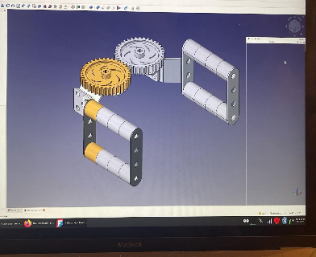

## Overview of the week

### Summary  
This week we got started on building our drivetrain and building our claw. Instead of building a cascade 2-bar, due to time constraints and lack of materials, we decided on building a DR4B instead. Our lift is still a work in progress and we have gathered parts for the lift but not yet started building. The issue is that we need mainly aluminum parts and we need matching parts but we are unable to find them. We swtitched up our idea for the claw. We had multiple issues with the drive train but it is now complete. We also were able to finally find aluminum parts instead of steel parts. We built our toggle parts and we now need to attach it to the final product.

### Claw \+ Toggle  
For our claw, we were planning on using the vex v5 claw kit to build a 2 sided claw but because we wouldn’t have gotten the materials in time so we decided to make a claw using what we have. We were originally thing of making a claw with two arms on both side which both move to grip the pin+cup.  
                    
*Original design plan for claw*   
By placing two 5x5 c-channels and attaching screw on all corners we made the claw arms. Then we attached a motor to one side of the claw so that one side clamps down while the other side stays stagnant. Although this sounds like it would be unstable, surprisingly it gripped the pin+cup very tightly and it made it easier for our drivers to grip the pin+cup. It also made it easier for our drivers to position the claw to hold the cup because by having on side stagnant, the other side clamps down making the clamping process more accurate. This is our current claw design and we might keep it permanently because it is working very well but we might also switch it up. We used the exact same toggle design as shown last week but istead of playing two stand offs on one L-channel we put one stand-off at the end of the L-channel. We only found steel L-channels so we will have to switch them out next week.

### DR4B  
Instead of doing a cascade 2 bar like we had planned last week we decided to create a DR4B the main reason being because, we don’t have much time or materials so we needed to make something efficiently. The materials for the cascade 2-bar have been ordered but we haven’t gotten a notice from our captains saying when they are coming. Instead by building a DR4B we can save time and it is more simple to create. We have gotten all of the parts for the DR4B and it is halfway assembled. The issue is that we have found maily steel parts. This means that our bot, which is already pretty slow, will be weighed down even more causing us to be slowing than a good majority of teams. A major obstacle currently is the fact that we don’t have many of the parts we need to build.

### Drivetrain  
Our drivetrain is near being complete. Although we were having issues with the spacing of the gears and the fact that it was so hard to find any, we finally finished our drivetrain. Although it is very slow it work pretty well. The issue discussed last week about how or drivetrain can be pushed is still relevant but there is nothing we can do about it. The only good part about having mainly steel for all of our parts is that it is really hard for anything to push our bot. Currently, we have a push-bot made so if all else fails, this might be what we put forward to compete. 
